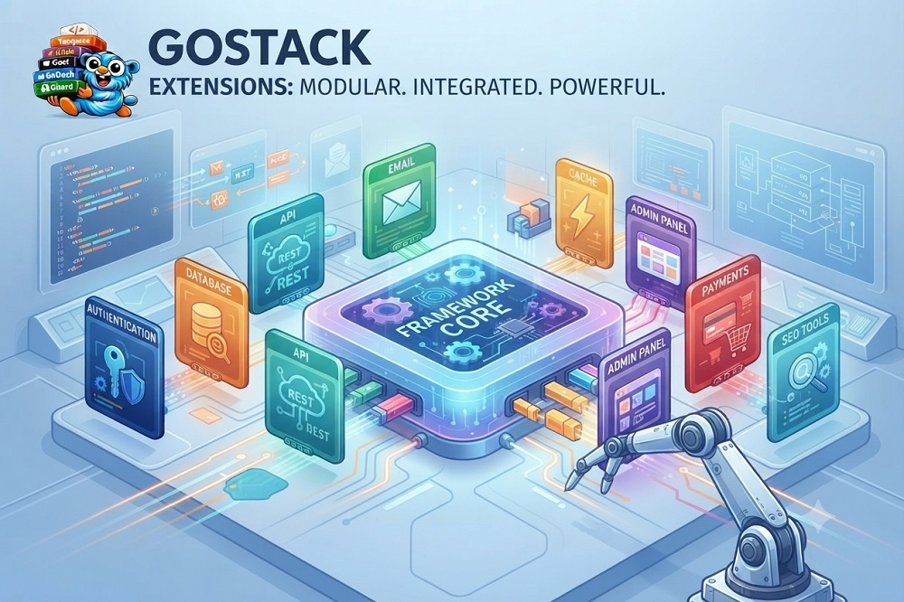

<p align="center">
  
</p>

<p align="center">
  <b>GoStack Extensions</b> — <i>Official modular plugins, adapters, and integrations for the GoStack Web Framework.</i>
</p>

<p align="center">
  
  
  
</p>

---

## 🔌 What are GoStack Extensions?

In modern web frameworks like **Laravel (Packages)**, **Django (Apps)**, and **NestJS (Modules)**, keeping the core framework lean is critical for maintenance, startup times, and horizontal scaling.

**GoStack Extensions** are official, plug-and-play packages that extend the GoStack framework's capabilities. They connect directly with GoStack's IoC container (**Citadel**), allowing developers to add advanced features—like Multi-Factor Authentication (MFA), Role-Based Access Control (RBAC), or Stateless JWT APIs—only when the application lifecycle demands it.

---

## 📦 Directory of Official Extensions

| Extension | Path | Purpose | Latest Version |
| :--- | :--- | :--- | :--- |
| **MFA / 2FA** | `/mfa` | Time-based One-Time Passwords (TOTP) QR code generation & verification. | `mfa/v1.0.0` |
| **RBAC** | `/rbac` | Database-backed Roles & Permissions table structure, route guards, and NoSQL/Cassandra resolvers. | `rbac/v1.0.1` |
| **JWT Auth** | `/jwt` | Stateless JWT token validation, bearer token extraction, and route guard middleware. | `jwt/v1.0.0` |
| **AI Toolkit** | `/ai` | PostgreSQL vector embeddings (pgvector), PromptTemplate composition, and Model Context Protocol (MCP) server. | `ai/v1.0.0` |
| **AI MongoDB** | `/ai-mongo` | MongoDB Atlas Vector Search adapter implementing the `ai.VectorStore` contract. | `ai-mongo/v1.0.0` |

---

## 🚀 1. MFA / 2FA Extension (`gostack-extensions/mfa`)

### What it is
The MFA extension provides secure Time-based One-Time Password (TOTP) generation and verification, adhering strictly to the **RFC 6238** standard. It enables developers to generate secret keys, construct Google Authenticator-compatible provisioning URLs, compile QR code images into base64 strings natively, and verify 6-digit codes.

### Installation
```bash
go get github.com/charledeon77/gostack-extensions/mfa@mfa/v1.0.0
```

### Setup & Usage
Register the provider in your application startup:
```go
app.RegisterProvider(mfa.NewServiceProvider())
```

Once registered, resolve the `Manager` from the Citadel container to generate and verify MFA:
```go
package controllers

import (
	"github.com/charledeon77/gostack-framework/framework/http"
	"github.com/charledeon77/gostack-extensions/mfa"
)

func Register2FA(ctx *http.Context) error {
	mfaManager := ctx.Get("mfa").(*mfa.Manager)

	// 1. Generate TOTP secret and provisioning URL
	secret, err := mfaManager.GenerateSecret("user@example.com")
	if err != nil {
		return err
	}

	// 2. Generate standard base64 PNG QR code url for the frontend
	qrCodeBase64, err := secret.QRImageBase64(256, 256)

	return ctx.JSON(200, map[string]string{
		"secret":  secret.Secret,
		"qr_code": qrCodeBase64,
	})
}

func Verify2FA(ctx *http.Context) error {
	mfaManager := ctx.Get("mfa").(*mfa.Manager)
	passcode := ctx.Post("passcode")
	userSecret := "USER_STORED_BASE32_SECRET"

	// 3. Verify the passcode against the user's secret
	if !mfaManager.Verify(passcode, userSecret) {
		return ctx.JSON(400, "Invalid passcode")
	}
	return ctx.JSON(200, "MFA Verified Successfully")
}
```

---

## 🚀 2. RBAC Extension (`gostack-extensions/rbac`)

### What it is
A flexible, high-performance Role-Based Access Control framework. Unlike monolithic RBAC systems that require SQL relational tables, this extension is designed with a **decoupled abstraction**. It supports:
1. **In-Memory RBAC:** Define roles and permissions directly in code.
2. **Relational Database RBAC:** Query standard DB tables automatically (configured to handle PostgreSQL/CockroachDB `$1` parameter formatting vs MySQL/SQLite `?` placeholders).
3. **Custom Callback Resolvers:** Supply custom closure handlers to resolve roles/permissions from Cassandra, MongoDB, or external REST clusters.

### Installation
```bash
go get github.com/charledeon77/gostack-extensions/rbac@rbac/v1.0.1
```

### Features & Setup
* **SuperAdmin Bypass Roles:** Set root roles (like `superadmin`) to bypass all checks automatically using `AddBypassRole`.
* **Direct User Permissions:** Bypass roles entirely by mapping specific permissions directly to a user ID.
* **Contextual Rules (Meta-Capabilities):** Build dynamic checks (such as checking if a user owns a post) by defining evaluation rules that accept runtime context.

```go
package main

import (
	"github.com/charledeon77/gostack-extensions/rbac"
)

func bootstrapRBAC(app *foundation.Container, db contract.Database) {
	rbacManager := rbac.NewManager(db)

	// 1. Define roles and permissions
	rbacManager.DefineRole("editor", []string{"create-post"})
	rbacManager.DefineRole("admin", []string{"create-post", "delete-post"})

	// 2. Add SuperAdmin bypass
	rbacManager.AddBypassRole("superadmin")

	// 3. Define Contextual Evaluation Rule (Meta-Capability)
	rbacManager.DefineRule("edit-post", func(userID any, context ...any) bool {
		if len(context) == 0 {
			return false
		}
		postOwnerID := context[0].(string)
		return userID == postOwnerID // Allow editing only if the user owns the post
	})

	app.BindSingleton("rbac", func(c *foundation.Container) any {
		return rbacManager
	})
}
```

### Route Protection Middleware
Use GoStack-compliant middleware to protect endpoints:
```go
// Restrict endpoint to administrators
router.Get("/admin/settings", adminSettingsHandler, rbac.RequireRole(rbacManager, "admin"))

// Restrict endpoint to users with 'delete-post' permission
router.Delete("/posts/delete", deleteHandler, rbac.RequirePermission(rbacManager, "delete-post"))
```

---

## 🚀 3. JWT Auth Extension (`gostack-extensions/jwt`)

### What it is
A stateless JSON Web Token (JWT) signature signing, verification, and authentication guard. This extension is built to eliminate the database lookup bottle-neck for high-traffic REST APIs by verifying token signatures cryptographically at the server level.

### Installation
```bash
go get github.com/charledeon77/gostack-extensions/jwt@jwt/v1.0.0
```

### Configuration (`.env`)
The ServiceProvider reads settings from your container's configuration:
```ini
JWT_SECRET=your-extremely-secure-256-bit-key-here
JWT_ALGORITHM=HS256
JWT_TTL=15m
```

### Usage
#### Step 1: Register the Service Provider
```go
app.RegisterProvider(jwt.NewServiceProvider())
```

#### Step 2: Generate Tokens on Login
```go
func Login(ctx *http.Context) error {
	jwtManager := ctx.Get("jwt").(*jwt.Manager)
	token, err := jwtManager.Generate(user.GetID(), user.Role)
	return ctx.JSON(200, map[string]string{"access_token": token})
}
```

#### Step 3: Secure Groups with Middleware
Apply the JWT middleware to route groups to automatically parse `Authorization: Bearer <token>`, verify it, and cache the authenticated user in GoStack's request context cache.
```go
apiGroup := router.Group("/api")
apiGroup.Use(jwt.Middleware(jwtManager, userProvider))
```

#### Step 4: Resolve Claims in Handlers
```go
func GetProfile(ctx *http.Context) error {
	claims := jwt.GetClaims(ctx)
	if claims == nil {
		return ctx.JSON(401, "Unauthenticated")
	}
	return ctx.JSON(200, map[string]string{"user_id": claims.UserID})
}
```

---

## 🤖 4. AI Toolkit Extension (`gostack-extensions/ai`)

### What it is
The AI extension provides the foundational data, retrieval, prompt composition, and agent tooling layer for GoStack applications:
* **PostgreSQL Vector Embeddings (`pgvector`)**: Native `Vector` type implementing `sql.Scanner` and `driver.Valuer`, distance metric operators (`<=>`, `<->`, `<#>`), and parameterized similarity query generation for Crafter.
* **PromptTemplate Composition**: Reusable, named prompt templates with built-in formatting helpers (`indent`, `trim`, `upper`, `truncate`, `default`) and the `.AsContext()` seamless bridge from vector search results.
* **Model Context Protocol (MCP) Server**: A standards-compliant JSON-RPC 2.0 endpoint enabling AI coding assistants (Claude Code, Cursor, Windsurf, Antigravity) to securely call application tools and inspect models.
* **Streaming Architecture**: Documented pattern for piping application LLM token streams directly through GoStack's native **GowSocket** WebSocket hub for zero-latency UI reactivity.

### Installation
```bash
go get github.com/charledeon77/gostack-extensions/ai@ai/v1.0.0
```

### Setup & Usage
Register the provider during application bootstrap:
```go
app.RegisterProvider(ai.NewServiceProvider())
```

---

## 🍃 5. AI MongoDB Adapter (`gostack-extensions/ai-mongo`)

### What it is
The MongoDB Atlas Vector Search adapter implements GoStack's `ai.VectorStore` contract on top of MongoDB Atlas `$vectorSearch` aggregations:
* **Atlas Vector Search**: Native integration with `$vectorSearch` pipeline stage and index-level metadata pre-filtering.
* **BulkWrite Batch Upserts**: `StoreBatch` executes high-throughput bulk upserts with zero client-side N+1 round trips.
* **Atlas Index JSON Helper**: `store.AtlasIndexJSON(dimensions)` generates the ready-to-paste Atlas index definition JSON for the Atlas UI or CLI.
* **Shared Types**: Works seamlessly with `ai.Document`, `ai.Vector`, `ai.SearchOptions`, and `ai.SearchResults`.

### Installation
```bash
go get github.com/charledeon77/gostack-extensions/ai@ai/v1.0.0
go get github.com/charledeon77/gostack-extensions/ai-mongo@ai-mongo/v1.0.0
```

### Setup & Usage
```go
import (
    "go.mongodb.org/mongo-driver/mongo"
    "github.com/charledeon77/gostack-extensions/ai"
    aimongo "github.com/charledeon77/gostack-extensions/ai-mongo"
)

coll := mongoClient.Database("myapp").Collection("knowledge_base")
store := aimongo.NewMongoVectorStore(coll, aimongo.Options{
    EmbeddingField: "embedding",
    IndexName:      "vector_index",
})

// Use store with the same ai.VectorStore interface:
err := store.Store(ctx, ai.Document{
    ID:        "doc-1",
    Content:   "GoStack with MongoDB Atlas Vector Search",
    Embedding: embeddingVector,
})
```

---

## ⚙️ How Extensions Connect to Citadel (DI)

Every GoStack extension follows the **ServiceProvider** pattern. During application bootstrap, the framework boots registered extensions in a strict two-phase pipeline:

```
                  +-----------------------------------+
                  |      Main Application Loader      |
                  +-----------------------------------+
                                    |
                                    v
                  +-----------------------------------+
                  |       app.RegisterProvider()      |
                  |  Loads extensions into memory     |
                  +-----------------------------------+
                                    |
            +-----------------------+-----------------------+
            |                                               |
            v                                               v
+-----------------------+                       +-----------------------+
|  1. Register() Phase  |                       |    2. Boot() Phase    |
| Binds singleton factory|                       | Safely resolve other  |
| recipes into Citadel. |                       | active container      |
| resolving credentials.|                       | dependencies.         |
+-----------------------+                       +-----------------------+
```

---

## 🤝 Contributing

We welcome contributions from the community!
1. Fork this repository.
2. Create your feature branch (`git checkout -b extension/my-awesome-feature`).
3. Commit your changes.
4. Push to the branch and open a Pull Request.

---

## 📄 License

This repository is open-sourced software licensed under the [Apache 2.0 License](LICENSE).
